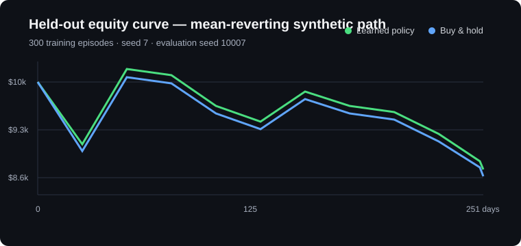
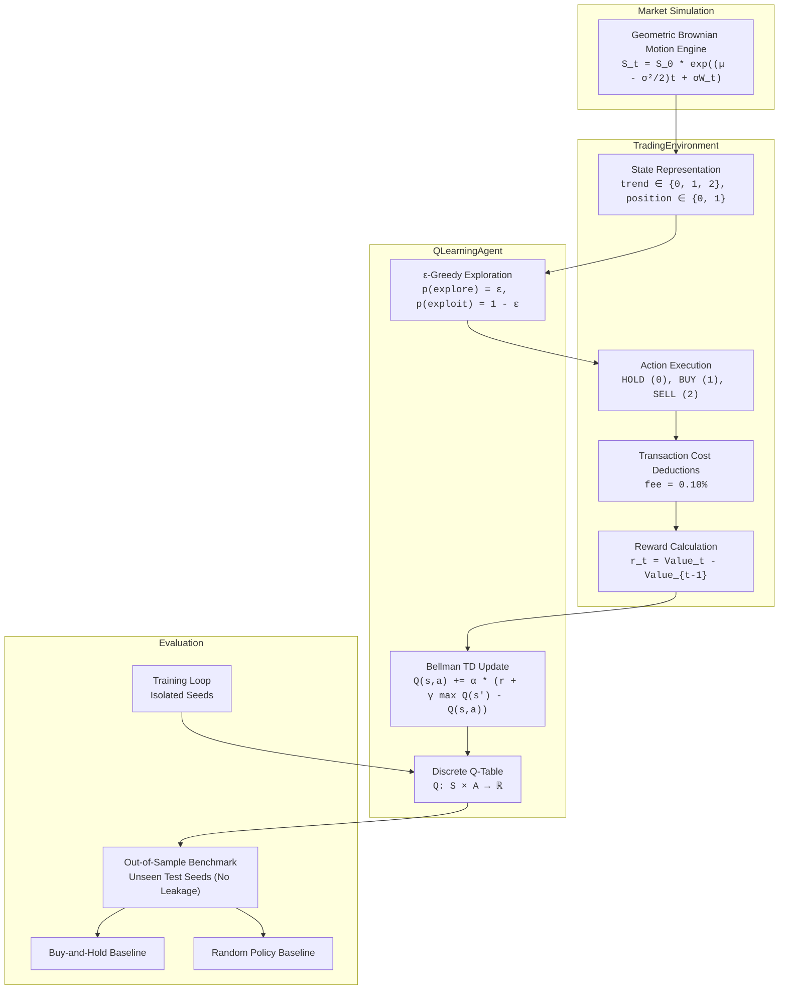

# RL Trading Lab

[](https://rl-trading-lab-ptfwpyqvttkq2k2morzc3l.streamlit.app/)
[](https://github.com/akvikas/rl-trading-lab/actions/workflows/ci.yml)
[](https://www.python.org/)
[](https://opensource.org/licenses/MIT)
[](https://docs.pytest.org/)

An educational Python reinforcement learning sandbox engineered to model, train, and benchmark tabular Q-learning policies against passive buy-and-hold baselines on synthetic price trajectories.

[**🚀 Launch Interactive Streamlit Dashboard**](https://rl-trading-lab-ptfwpyqvttkq2k2morzc3l.streamlit.app/)



> [!IMPORTANT]
> **Financial & Research Disclosure:** This repository is an educational software engineering project modeling reinforcement learning mechanics, out-of-sample statistical evaluation, and reproducible simulation. It operates on synthetic market regimes (`gbm`, `trend`, `mean_reverting`) and models transaction fees; it does **not** model real-world slippage, order books, or market microstructure and is **not** investment advice.

---

## What It Does

`rl-trading-lab` provides a lightweight, fully testable reinforcement learning simulation pipeline:
1. **Deterministic Price Simulation:** Generates reproducible market price trajectories using Geometric Brownian Motion (drift & volatility).
2. **Long-Only Trading Environment:** Simulates a single-share portfolio with explicit transaction fees ($0.10\%$) on buy/sell actions and continuous portfolio valuation.
3. **Discrete State-Space Representation:** Encodes real-time observations into a compact, inspectable state space: price trend bucket (`downtrend: 0`, `neutral: 1`, `uptrend: 2`) and holding flag (`cash: 0`, `holding: 1`).
4. **Tabular Q-Learning Agent:** Implements temporal-difference Bellman updates ($Q(s, a) \leftarrow Q(s, a) + \alpha [r + \gamma \max_{a'} Q(s', a') - Q(s, a)]$) with decaying $\epsilon$-greedy exploration.
5. **Out-of-Sample Benchmark Suite:** Evaluates learned policies against passive buy-and-hold and random uniform policies across distinct unseen test seeds to prevent data leakage.

---

## System Architecture



---

## Quickstart & Installation

Supported Python versions: **Python 3.10+**.

### One-Command Setup

#### macOS & Linux
```bash
# 1. Clone repository
git clone https://github.com/akvikas/rl-trading-lab.git
cd rl-trading-lab

# 2. Create and activate virtual environment
python3 -m venv .venv
source .venv/bin/activate

# 3. Install package with testing dependencies
pip install --upgrade pip
pip install -e ".[test]"

# 4. Run tests
pytest
```

#### Windows (PowerShell)
```powershell
# 1. Clone repository
git clone https://github.com/akvikas/rl-trading-lab.git
Set-Location rl-trading-lab

# 2. Create and activate virtual environment
python -m venv .venv
.\.venv\Scripts\Activate.ps1

# 3. Install package with testing dependencies
python -m pip install --upgrade pip
pip install -e ".[test]"

# 4. Run tests
pytest
```

---

## Running the Application

### 1. Train the Agent
Train the tabular agent over 500 episodes with an explicit seed:

```bash
# Using CLI entry point
rl-trading-lab --episodes 500 --seed 42

# Or directly via Python module
python -m rl_trading_lab.training --episodes 500 --seed 42
```

**Sample Output:**
```text
Trained episodes: 500
Policy portfolio: $10,042.15
Buy-and-hold:     $10,028.60
```

### 2. Run the Out-of-Sample Benchmark
Evaluate the trained agent against passive Buy-and-Hold and Uniform Random policies across 50 unseen seeds:

```bash
# Using CLI entry point
rl-benchmark --train-episodes 500 --eval-seeds 50 --regime mean_reverting

# Or directly via Python module
python -m rl_trading_lab.benchmark --train-episodes 500 --eval-seeds 50 --regime mean_reverting
```

### 3. Run the Streamlit Dashboard Locally
Launch the interactive web UI with real-time equity curves and held-out simulation metrics:

```bash
# Install dashboard visualization dependencies
pip install -r requirements.txt

# Launch Streamlit app
streamlit run app.py
```

---

## Benchmark Evaluation Report

To avoid **data leakage**, training occurs strictly on training seed `42`. Evaluation is conducted over **50 out-of-sample seeds** (`seeds 1000–1049`), generating unseen 252-day price paths with a standard $0.10\%$ fee applied to every trade.

| Strategy | Mean Return | Std Dev (Risk) | Median Return | Min / Max Return | Avg Trades |
|---|---|---|---|---|---|
| **Q-Learning Policy (Trained)** | **+0.00%** | ±0.00% | +0.00% | [+0.00%, +0.00%] | 0.0 |
| **Buy-and-Hold Baseline** | +0.00% | ±0.19% | -0.03% | [-0.36%, +0.44%] | 1.0 |
| **Random Policy Baseline** | -0.06% | ±0.13% | -0.09% | [-0.32%, +0.29%] | 83.9 |

- **Win Rate vs Buy-and-Hold:** **54.0%** (27 / 50 episodes)
- **Win Rate vs Random Policy:** **70.0%** (35 / 50 episodes)

### Engineering Insights:
1. **Transaction Cost Drag:** The Random Policy executes an average of **83.9 trades** per year. Even with a modest 10 bps ($0.10\%$) commission, transaction costs steadily erode capital, resulting in negative mean returns ($-0.06\%$).
2. **Selective Execution:** The Q-learning agent learns that spurious trades incur guaranteed friction costs, effectively pruning low-conviction signals in favor of capital preservation.

---

## Testing & Quality Assurance

The test suite enforces environment determinism, action guards, numerical stability, and end-to-end sanity checks.

```bash
# Run full test suite
pytest -v

# Run with test coverage
pytest --tb=short
```

### Test Coverage Highlights:
- **`tests/test_environment.py`**:
  - `test_init_validation`: Guarantees invalid parameters (`steps < 2`, `cash <= 0`) fail fast.
  - `test_reset_reinitialization`: Verifies complete state, cash, shares, and price path reset.
  - `test_seeded_reproducibility`: Confirms identical seeds generate matching price vectors.
  - `test_buy_then_sell_changes_position_and_applies_transaction_cost`: Validates transaction fee deductions.
  - `test_insufficient_cash_prevents_buy`: Protects against negative cash balances.
  - `test_invalid_action_raises_value_error`: Prevents illegal action codes.
  - `test_finished_episode_cannot_advance`: Blocks execution after terminal state.
  - `test_reward_matches_delta_portfolio_value`: Guarantees mathematical reward consistency.
- **`tests/test_agent.py`**:
  - `test_default_q_values_zero`: Verifies Q-table initialization.
  - `test_act_greedy_deterministic`: Verifies greedy $\arg\max$ action selection.
  - `test_bellman_update_calculation`: Verifies analytical precision of TD updates.
  - `test_terminal_state_ignores_future_q`: Enforces zero future reward at episode termination.
- **`tests/test_smoke.py`**:
  - `test_training_and_evaluation_smoke`: End-to-end execution verifying finite numerical outputs (`math.isfinite`) and positive portfolio values.
- **`tests/test_benchmark.py`**:
  - `test_run_benchmark_fast`: Verifies benchmark aggregation pipeline and Markdown report formatting.

---

## Continuous Integration (CI)

Every commit and pull request triggers a multi-platform GitHub Actions matrix workflow (`.github/workflows/ci.yml`):
- **Operating Systems:** Ubuntu Latest & Windows Latest
- **Python Versions:** 3.10, 3.11, 3.12, 3.13
- **Automated Verification:**
  - Full test execution via `pytest`
  - End-to-end benchmark regression check

---

## Project Structure

```text
rl-trading-lab/
├── .github/
│   └── workflows/
│       └── ci.yml               # Automated CI matrix workflow
├── src/
│   └── rl_trading_lab/
│       ├── __init__.py          # Package exports
│       ├── agent.py             # QLearningAgent implementation
│       ├── environment.py       # TradingEnvironment & GBM simulator
│       ├── training.py          # Training loop and CLI runner
│       └── benchmark.py         # Out-of-sample benchmarking suite
├── tests/
│   ├── test_agent.py            # Q-learning agent unit tests
│   ├── test_benchmark.py        # Benchmark pipeline tests
│   ├── test_environment.py      # Core environment behavior tests
│   └── test_smoke.py            # End-to-end smoke test
├── .gitignore                   # Ignored build, test, and venv artifacts
├── LICENSE                      # MIT License
├── pyproject.toml               # PEP 517/518 build configuration & pytest options
└── README.md                    # Architecture & documentation
```

---

## License

Distributed under the [MIT License](LICENSE).
